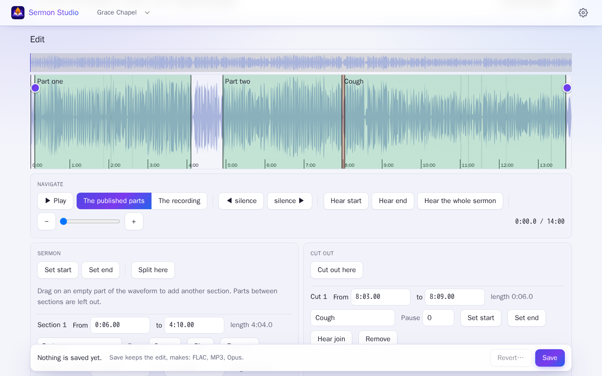
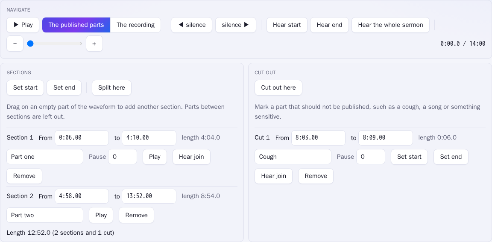
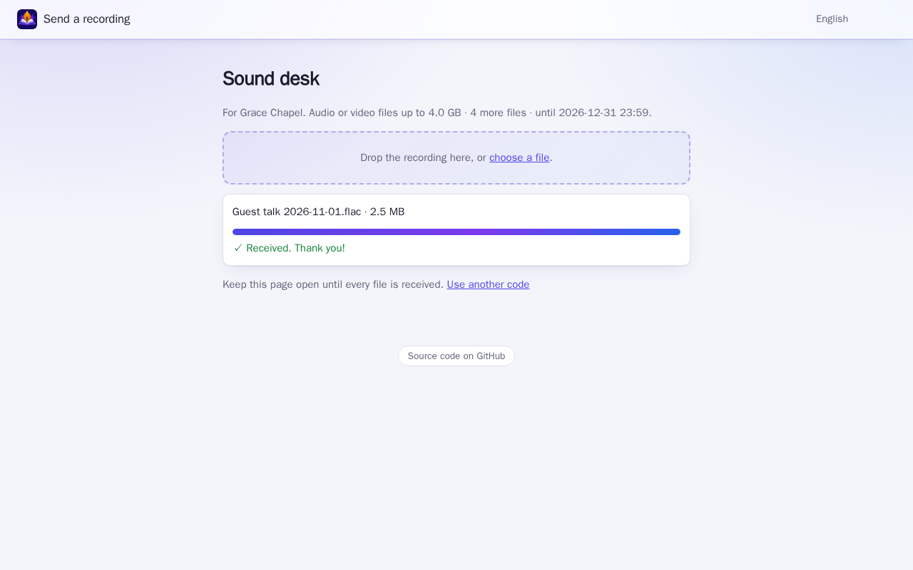
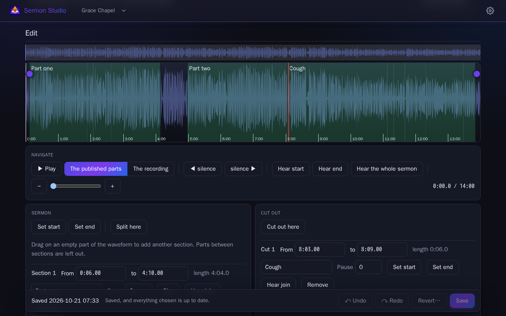

# Sermon Studio

**Turn a recording of a church service into publish-ready sermon files.**
Cut the sermon out on a waveform. Get evenly loud FLAC, MP3 and Opus, ready for podcast services.

[](https://github.com/gunnaringe/sermon-studio/actions/workflows/image.yml)
[](LICENSE)




## The problem

A church service is recorded in one piece: welcome, songs, prayers, the sermon, more songs. What
you want to publish is the sermon, at a volume people can listen to in the car, in a format every
podcast service accepts. Doing that by hand means an audio editor, a loudness meter and a handful of
ffmpeg commands, every week.

Sermon Studio does it in the browser. Drop in the recording, mark what to keep, press Save.

## What it does

**Cut on a waveform.** See the whole service, jump between silences, drag out the parts to keep.
Keep one section or several, cut out a cough or a song in the middle, and label them. Cut while you
listen: press once where a part starts and again where it ends. Hear the join before you commit, and
undo any step. Nothing is ever cut from the original.



**Even, standard loudness.** Speech and music are recorded at very different levels. The output is
mixed to mono (or kept stereo), noise-reduced, and normalised to podcast loudness (-19 LUFS, measured
with EBU R128, true peak limited), then encoded to **FLAC, MP3 and Opus**.

**Recordings arrive however they arrive.** Upload from the browser (large files in chunks, resumable),
let a recorder drop files in a church's inbox folder, or hand a sound technician a **share code** for a
public upload page that needs no login. WAV, AIFF, FLAC, MP3, M4A, Ogg, Opus, WMA and video files
(the sound is copied out unchanged) all work.




**Safe by design.** The original recording is kept, whole, next to the results. A file is deleted
only after its copy is verified identical. Outputs are written to a temporary name and renamed when
complete, so a crash never leaves a half-written file. Everything about a recording lives in one
`recording.json` next to its files.

**Made for several churches and for phones.** One folder per church, each with its own default tags,
names, logo and users. The interface is in English, Norwegian bokmål and nynorsk, in a light or dark
theme, and the editor works with a finger [on a phone](docs/img/18-phone-editor.png).



## How it works

```
 recording ──► upload / inbox folder / share code
                      │
                      ▼
           converted (WAV → FLAC, video → audio), checked identical
                      │
                      ▼
      cut on the waveform: sections, cuts, labels, fades
                      │  Save
                      ▼
   mono · noise reduction · loudness · FLAC, MP3, Opus   (original kept)
```

A recording is a folder named after its date:

```
2026-10-18/
  2026-10-18.flac   2026-10-18.mp3   2026-10-18.opus     the finished files
  recording.json                                           what it is, the cuts, how each file was made
  original/2026-10-18_raw.flac                             the whole recording, untouched
```

## Under the hood

One Go binary, **standard library only**, with ffmpeg run as a command. The frontend is plain
JavaScript with [wavesurfer.js](https://wavesurfer.xyz/) for the waveform: no framework and no build
step. State is plain files in the data folder, so there is no database to run or back up. The
studio has no login of its own: put it behind your login proxy, or on a trusted network. The
public upload page is a separate listener that can reach nothing but itself. See
[SECURITY.md](SECURITY.md).

## Documentation

| | |
|---|---|
| [User guide](docs/guide.md) | Uploading, cutting, saving, sharing: with pictures |
| [Running it](docs/running.md) | Docker, the data folder, all flags |
| [Access control](docs/access.md) | Which user sees which church |
| [What a run makes](docs/outputs.md) | The files, loudness targets and options |
| [Design](docs/design.md) | Background and decisions |
| [Contributing](CONTRIBUTING.md) | Build, test and pull requests |

## Run it yourself

You need Docker (or Go 1.25 and ffmpeg). The image includes ffmpeg.

```bash
git clone https://github.com/gunnaringe/sermon-studio && cd sermon-studio
docker build -t sermon-studio .
mkdir -p data/my-church/Taler data/my-church/Innboks cache
docker run --rm -p 8080:8080 -u "$(id -u):$(id -g)" \
  -v "$PWD/data:/data" -v "$PWD/cache:/cache" \
  sermon-studio --data-dir /data --cache-dir /cache
```

Open <http://localhost:8080>. Each folder in `data/` is a church; add more from the app. All options
and the public upload page are in [docs/running.md](docs/running.md).

## License

[Apache 2.0](LICENSE). The documentation's example recording is President Kennedy's inaugural address
(1961), a US government work in the public domain
([source](https://commons.wikimedia.org/wiki/File:JFK_inaugural_address.ogg)).
