# Using Sermon Studio

What each part does, in the order you meet it. Settings for the server are in [running.md](running.md); what the files are is in [outputs.md](outputs.md).

The pictures show a real speech: President Kennedy's inaugural address (1961), 14 minutes, uploaded as a WAV.

## Contents

1. [The recordings page](#the-recordings-page)
2. [Uploading](#uploading)
3. [Cutting: sections and cuts](#cutting-sections-and-cuts)
4. [Saving and the files](#saving-and-the-files)
5. [Sharing an upload page](#shares)
6. [Settings, tags, language and theme](#tags)

## The recordings page

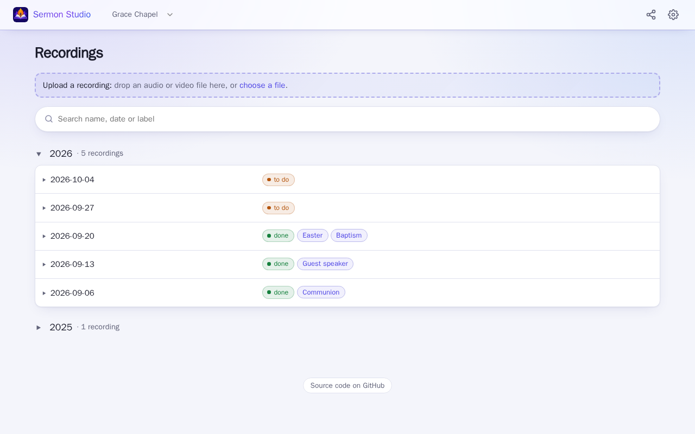

Every recording of the church, by year; the newest year is open. *to do* means not cut yet, *done* means
saved with files. The search finds names, dates and labels.

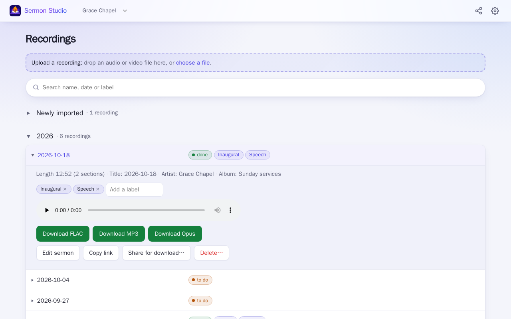

## Uploading

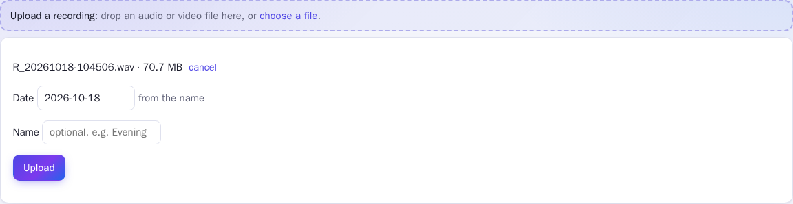

Drop a file on the top of the page or choose one; the date is taken from the file name or the file. The
upload goes straight into its date folder and opens in the editor.

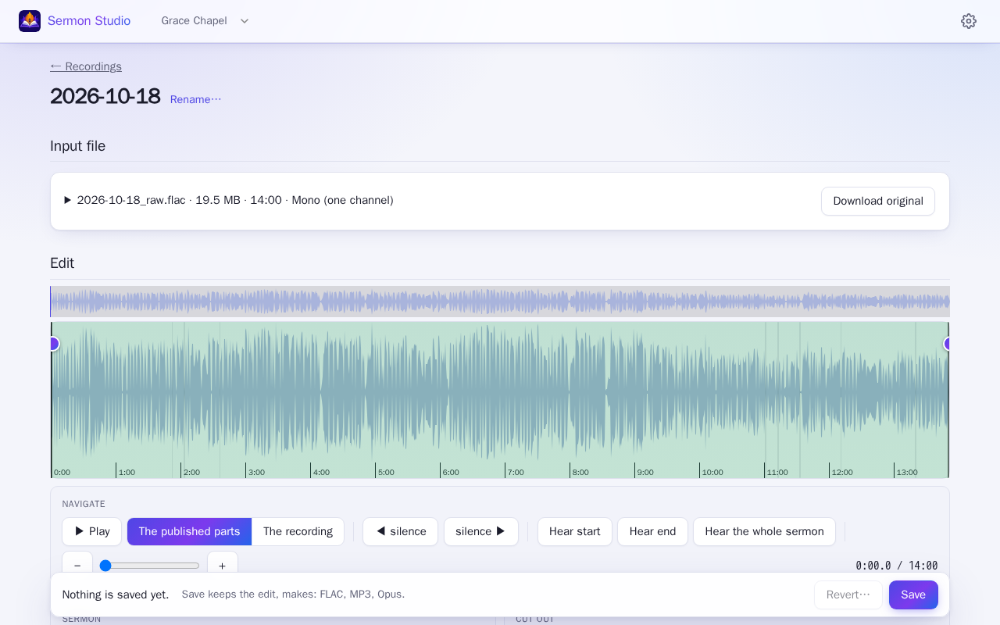

## Cutting: sections and cuts

Sections are what to keep; what is between them is left out. A cut takes a part out of a section (a cough, a song).
Each can have a label, which shows on the waveform.

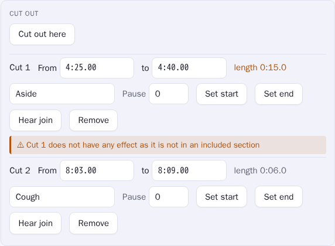

## Saving and the files

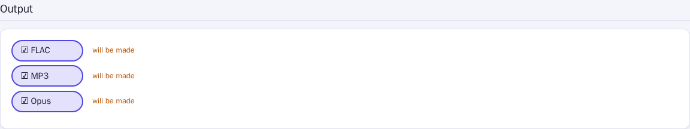

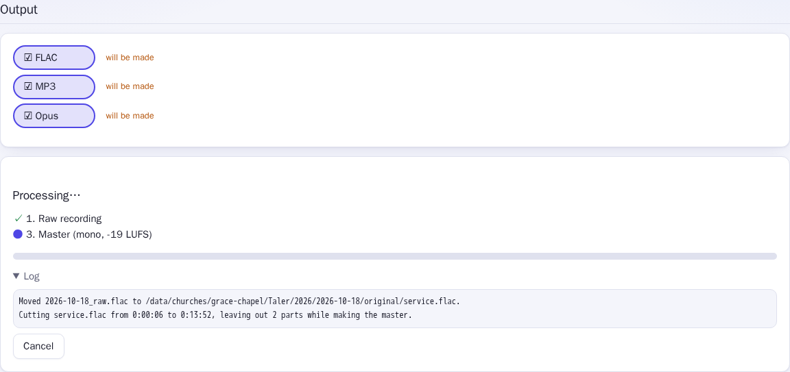

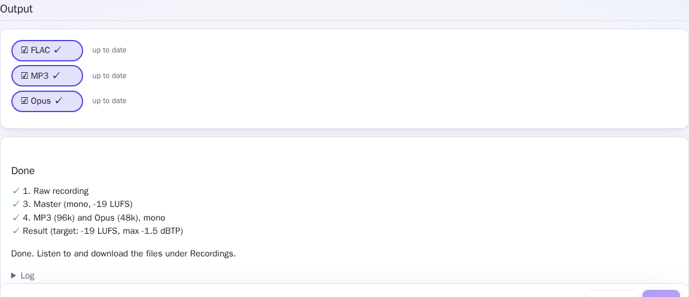

## In detail

- **Recordings** (the one page, `#/<church>`): the upload, a search field, **Newly imported** (arrived in the last 7 days, newest
  first, with when), then the years, each folded open on its own (the newest at first; the browser remembers). A row opens the
  recording's details in place. **Labels** are your own tags on a recording ("Easter", "guest speaker": up to 10, 30 characters; added with the + button, Enter or a comma, or picked from the labels already in use;
  removed with the × on the pill, kept as `labels` in `recording.json`, not written into the files). The search matches name, date and labels
  in every year at once (all words must match); a label on a row searches for it. **Copy link** gives the address of one recording,
  `#/<church>/recording/<path>`, which opens the page with its year and row open and scrolled to.
- **Editor:** the whole service as a waveform with a minimap overview, like Audacity or
  ocenaudio. The controls are in three groups. **Navigate:** play, jump between silences
  (grey on the waveform), zoom (slider, `+`/`-`, or scroll over the waveform: zooms at the
  mouse; shift+scroll moves along; *Settings › Waveform* can make it need ctrl/cmd). **Sermon:** drag on the waveform
  to select the sermon and drag the edges to adjust, or set the start and end at the playhead;
  *Hear start*, *Hear end* and *Play sermon* check the cut. The from/to fields follow the
  selection and can be typed in (`h:mm:ss`, `mm:ss` or seconds, with decimals if needed).
  The sermon can be **several sections** (below). **Cut out:** parts of the sermon that should
  go, such as a song in the middle (below).
  Keys: `space` play, `s`/`e` start/end at the playhead (of the section there, or the next/previous one), `c` cut out here, `[`/`]` previous/next
  silence, ←/→ 1 s (shift 0.1 s), `p` play the sermon.
- **On a phone:** every page fits the screen. Drag a finger along the waveform to select (up and
  down still scrolls the page); the section edges are wider to grab; cut with *Cut out here* and
  zoom with the buttons.
- **The page** has four parts: **Input file** (the recording: name, format, how it came, its
  metadata, whether it is stereo or mono in effect, and *Download original*), **Edit** (the
  waveform, sections, cuts and fades), **Options** (mono ↔ stereo, tags, sound) and **Output**.
- **Saved version:** the sections, the cuts and the fades are kept in `recording.json` in the date
  folder (it follows a rename) as you change them: these are the *adjustments*, and they are back
  the next time the sermon is opened. **Save** (under Output) makes them the *saved version*,
  which stays as it is while you adjust further, and makes the files; **Revert…** (after a
  confirmation) throws the adjustments away and goes back to it. Both versions are in the file.
- **Several sections:** drag on an empty part of the waveform to add another section; the parts
  between sections are left out, as if cut. Use whichever feels natural: one section with cuts,
  or several sections (or both). Sections that come to overlap become one; *Remove* drops one.
- **Cutting parts out:** with the sermon selected, *Cut out here* (or `c`) marks 10 s from the
  playhead as a cut, shown in red; or hold shift and drag on the waveform. Adjust a cut by
  dragging its edges, typing its times, or *Set start* / *Set end* at the playhead. A cut outside
  the sections is allowed (what is outside is left out anyway) but does nothing, and a warning by it says so (also when it is only
  partly in a section). Every section and cut can have a **label** ("Intro", "Song"), shown on the waveform and kept
  with the edit; labels change nothing in the files. *Hear join* plays 3 s either side of a cut as it will sound, and with
  *Play without the cuts* (on by default) playback jumps over the cuts and the gaps between sections. The outputs are made from
  what is left, joined with a 15 ms fade on each side so the join does not click; the length
  shown is that of the sections after the cuts.
- **Options:** checked as you change them; your choices carry over to the next folder. Mono or
  stereo is a switch; choosing stereo for a recording that is mono in effect (one channel,
  identical channels, or one side silent) shows a warning.
- **Output:** a pill per format (FLAC, MP3, Opus), one under the other: click to choose it,
  green when the file is there (play and download it from the recordings list). `recording.json` keeps what each file was made from (sections, cuts,
  fades, sound, tags, bitrate), so a file made from other settings than the page shows says
  *out of date*; files made from the recordings list count too. The choice is the recording's own (not
  carried over): it starts with the formats it has, or the defaults when it has none; a file whose format is no longer chosen says *will be deleted*.
  **Save** saves the edit, then makes the chosen formats that are missing or out of date and
  deletes the files of those not chosen (never the recording), asking first when it deletes a
  file. The edit is saved even if the files cannot be made right then. The run is followed live and
  keeps going if the browser is closed. Cancelling leaves nothing half-written.
- **Status** on the recordings page, worked out from what is there: *to do* (not cut yet), *done*
  (a saved version, or files made), and next to it *no files* or *files out of date* (made from
  another cut than the saved one) when Save has more to do; *converting*, *preparing* and
  *processing* while the server works on it.
- **Newly imported:** a recording that arrived (upload, inbox, share) in the last 7 days is also listed
  on top of the first page, with when it came; the import time is kept in its `recording.json`.
- **Upload** (at the top of the recordings page): drop or pick the recording and its date (suggested from the file name or the file's
  date); it goes straight into the date folder (`<year>/<date>/<date>_raw.*`, see `--layout`).
  Uploads are sent in chunks, so they pass proxies that limit request size (Cloudflare: 100 MB)
  and continue after a dropped connection. No inbox needed.
- **Names:** a recording can have a name (upload form, optional), e.g. for two sermons a day. Its folder is
  `<year>/<date> <name>` and its files `<date> <name>_raw.flac`, `<date> <name>.mp3`... Without a name
  a date can hold one sermon. **Rename…** on a sermon's page changes its date or name (the folder and
  the files named after it, also in `original/`; files already made keep their tags). A recording
  from the inbox that finds its date taken lands in `<date> 2`; rename it.
- **Inbox** (with `--inbox`): recordings that arrive by other means go into their date folder
  by themselves (see below); there is no inbox page. The recordings list shows a "converting" or
  "preparing" tag while a recording is made ready.

**Recordings may be any common audio or video file**: WAV, AIFF, FLAC, MP3, M4A/AAC, Ogg, Opus,
WMA, or a video (MP4, MOV, MKV, WebM). As soon as one arrives (upload, inbox, share, or opening a
folder that has one):
- **WAV and AIFF are converted to FLAC**, verified identical by MD5 of the audio, and then the
  original is removed;
- **a video's sound is copied out**, unchanged, into `.mka` (Matroska audio), verified packet for
  packet, and then the video is removed;
- **FLAC and compressed audio are kept as they are**: FLAC would only make an MP3 bigger.

Right after, the server prepares the waveform and the listening preview, so cutting can start
at once.

## Shares

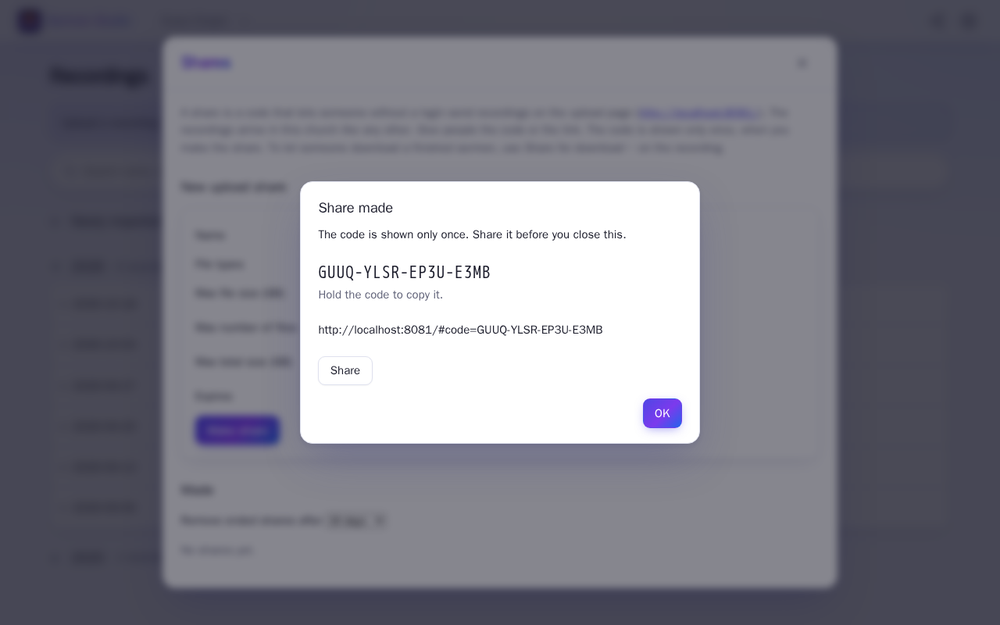

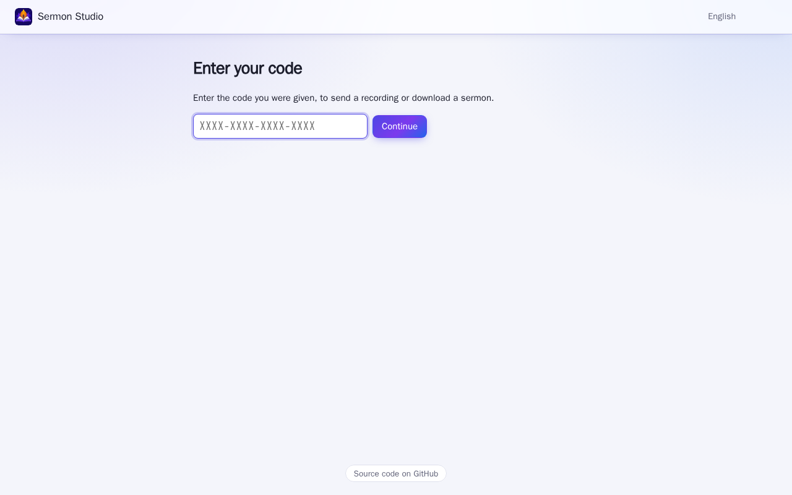

With `--share-listen`, people without a login can send recordings to a church's inbox on a
separate, public upload page, with a code. **Settings → Shares** in the studio makes one: a name, the file
types (all supported audio, or some of them), the max file size, and optionally how many files, how much
in all and an expiry. The code (`XXXX-XXXX-XXXX-XXXX`, 80 bits) and a link with it (`<share-url>#code=...`)
are shown once, with a Share button for the link (hold the code to copy it); the church keeps only a hash,
in `<church>/shares.json`, with the uploads made (name, size, address, time). A share can be revoked:
refused at once, also mid-upload (after a confirmation); it stays in the list with what came in. A share
that no longer takes uploads (revoked, expired, used up, full) can be removed from the list, one by one or
all at once; the files it brought stay.

The upload page asks for the code, or takes it from the link and removes it from the address bar
(it is in the fragment, so it never reaches the server's or a proxy's logs). Files go in 16 MB
chunks, so they pass Cloudflare, and continue after a dropped connection, a reload or a restart.
They are written as `Innboks/.share-<id>.partial`, checked to be the type they claim, and renamed
when complete (never over a file: `name (2).wav`); then they are ingested like any inbox file.
Half-written files (stopped uploads, here or in the studio, and encodes cut off by a crash) are
removed once they have sat untouched for a day; the server looks every hour.

Run the upload page on its own host, **not** behind the login proxy, and keep the studio behind
it. The page serves only itself and `api/share/*`: nothing of the studio, nothing to list or
download. Every request carries the code; wrong codes and requests are limited per address and in
all (flags above), and an upload is refused when the disk would get within 1 GB of full.

## Tags

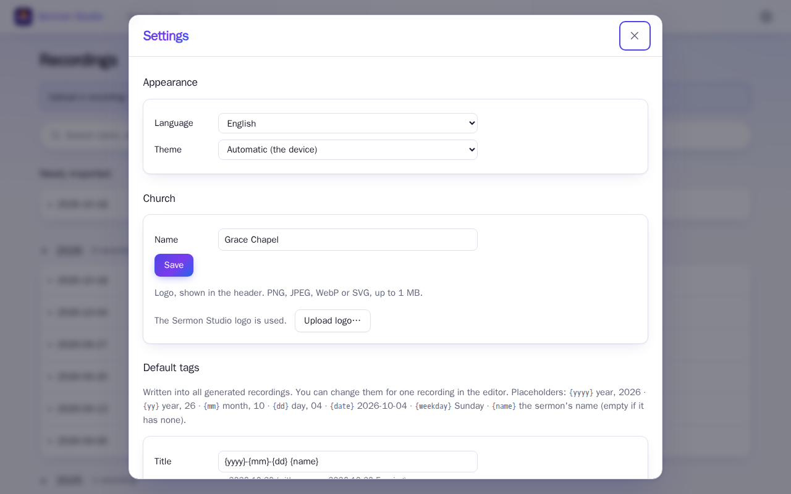

Every output (FLAC, MP3, Opus) gets title, artist, album and date tags. The **Settings** overlay (the gear in the header; closes with ✕, Esc or a click outside) sets
the defaults of the selected church, as templates: the title starts as `{yyyy}-{mm}-{dd}`. Placeholders:
`{yyyy}` `{yy}` `{mm}` `{dd}` `{date}` (2026-10-04) `{weekday}` and `{name}` (the sermon's name, empty
if it has none); an unknown one is refused. They are filled in from the date folder's name
(`2026-10-04` or `2026-10-04 Name`). The sermon's page shows the result and lets you change it for
one run; a field you empty is left out. Saved in the church's `church.json` (with
`--root` alone the settings last until restart).

## Inbox

- **The inbox is any folder**: a synced folder or a file share. A recording (any of the types
  above) that has stopped changing for 30 s is moved into its date folder as `<date>_raw.*`
  (and converted and prepared there), without anyone opening it. The date is taken from the
  file name, else the recording's tags, else its modification time. If that date already has a
  raw recording, the new one goes in `<date> 2`, `<date> 3`... Hidden files and `*.partial*`
  are ignored, so write under such a name and rename when done if you can.

When a recording is opened the first time, the server prepares its waveform and a small MP3
preview for listening (about 35 s for 90 minutes), kept in `--cache-dir` and kept
when a recording is moved. The preview is
normalized (up to 40 dB of dynamic gain), so even a very quiet recording can be heard while
cutting; the waveform keeps the original levels, where loud music and quieter speech stand
apart. The browser only streams the preview; the cut is always made from the original.

## Language and theme

The interface is in English, Norwegian bokmål and Norwegian nynorsk. It follows the browser's language (Norwegian
`no` is bokmål; anything else is English) until you choose one in **Settings → Appearance**, where the theme is also set:
automatic (the device's light or dark), light or dark. Both are kept in the browser. The public upload page follows the
browser too and has a language choice in its header. Messages from the server are translated where they are known
(`web/static/locales.js`); the tags written into files (like the `{weekday}` name) are not translated. The footer links to
the source on GitHub.
